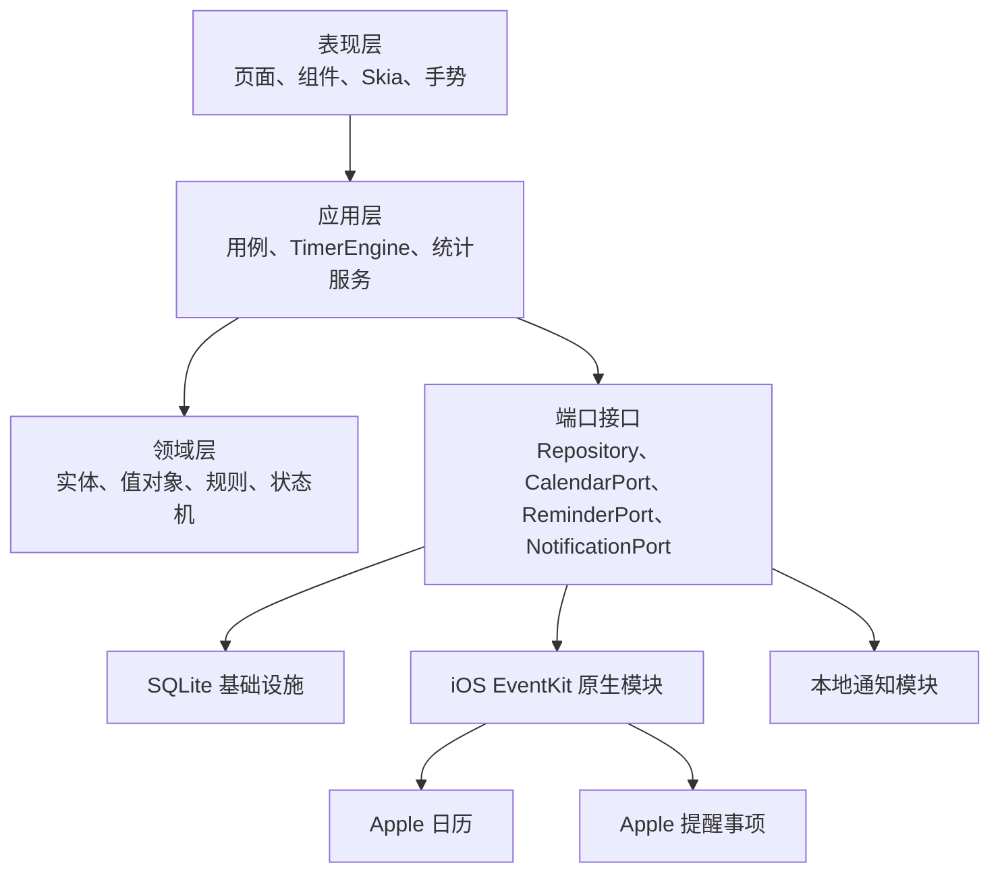
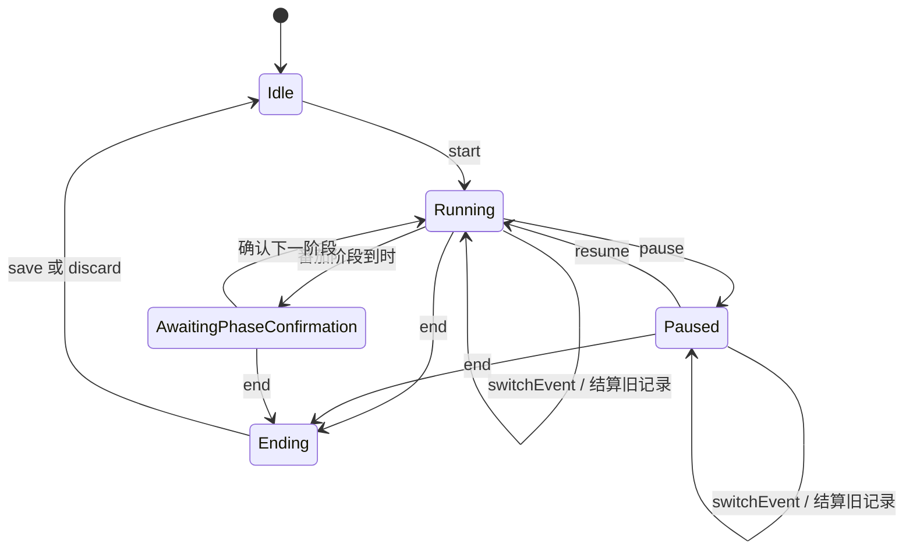

# 时间统计 App 技术设计方案

> 文档状态：第一版开发基线
> 对应功能文档：`功能设计方案.md`
> 目标平台：iPhone
> 技术方向：React Native + iOS 原生模块 + 本地优先数据架构
> 更新日期：2026-07-30

---

## 1. 技术目标

本方案负责把功能设计转换为可开发、可测试、可演进的软件结构。第一版优先保证以下能力：

1. 计时在前台、后台、闪退、系统终止和设备重启后仍能正确恢复；
2. 首页弧形时间轴、双层事件圆弧和视图页双时间轴保持流畅；
3. 可靠读写 Apple 日历与 Apple 提醒事项；
4. 拒绝 Apple 权限时，本地日程、本地待办和计时核心功能仍可独立工作；
5. 所有关键记录先写入本地数据库，不依赖自建服务器；
6. 数据结构为未来 Android、iCloud 同步和内购预留边界，但不提前实现；
7. 功能模块可以分阶段交付，每一阶段都能独立测试。

### 1.1 非目标

第一版不实现：

- Android、iPad、Web 和桌面端；
- 自建用户账号和云服务器；
- CloudKit 跨设备同步；
- 数据导出；
- 内购和恢复购买；
- 完整日历、完整待办、共享协作、附件和地点提醒；
- 依赖应用持续在后台运行的“后台计时进程”。

---

## 2. 核心技术决策

| 领域 | 选型 | 决策 |
| --- | --- | --- |
| UI 框架 | React Native + TypeScript | 共享业务与界面代码，同时保留 iOS 原生能力 |
| 工程框架 | Expo Development Build | 使用 Expo 工具链，但不使用受限的 Expo Go 作为正式开发环境 |
| React Native 架构 | New Architecture | 使用 Fabric、TurboModules 所在的新架构，不主动回退旧架构 |
| 导航 | Expo Router | 四个一级页面使用底部 Tabs，详情与编辑使用 Stack／Sheet |
| 本地数据库 | SQLite（`expo-sqlite`） | 事实数据持久化、事务、索引和迁移 |
| 数据访问 | Repository + 参数化 SQL | 领域层不直接依赖 SQLite；复杂统计允许使用专用 SQL |
| UI 短期状态 | Zustand | 只存选择、滚动位置、临时面板等可重建状态 |
| 异步查询缓存 | TanStack Query | 管理 SQLite/EventKit 查询、失效和刷新，不作为事实数据源 |
| 图形绘制 | React Native Skia | 绘制上下时间弧、双层圆弧和高密度时间轴 |
| 手势与动画 | Gesture Handler + Reanimated | 手势识别、吸附、惯性、回弹和 UI 线程动画 |
| Apple 日历／提醒事项 | EventKit + EventKitUI | 通过本地 Expo Swift 模块封装 |
| 本地通知 | `expo-notifications` / UserNotifications | 番茄钟阶段提醒和临期提醒 |
| 校验 | Zod | 校验设置、原生模块返回值和编辑表单 |
| 单元／组件测试 | Jest + React Native Testing Library | 领域逻辑和组件交互 |
| iOS 原生测试 | XCTest | EventKit 桥接、时间和权限状态转换 |
| 端到端测试 | Maestro | 核心用户路径与回归测试 |
| 包管理 | pnpm | 固定锁文件，减少依赖安装差异 |

### 2.1 版本策略

- 建项时使用当时最新稳定的 Expo SDK，并使用该 SDK 官方配套的 React Native 版本；
- 第一版基线按 Expo SDK 57 级别的工具链设计，不手工混装不匹配的 React Native 版本；
- 最低系统版本设为 iOS 17；
- 使用当前 LTS Node.js 和稳定版 pnpm；
- 所有 JavaScript、Swift、CocoaPods 和构建工具版本写入锁文件或构建配置；
- 大版本升级单独建分支，先跑数据库迁移和计时恢复回归测试，再合入主线。

选择 iOS 17 的原因是 EventKit 从 iOS 17 起明确区分日历写入权限和完整访问权限。本应用需要读取、修改已有日程并读取提醒事项，因此必须申请日历完整访问和提醒事项完整访问。

---

## 3. 总体架构

采用“本地优先的分层模块化单体”，不引入微服务或远程后端。



### 3.1 分层职责

#### 表现层

- 页面布局和导航；
- Skia 图形绘制；
- 手势识别和视觉反馈；
- 展示 ViewModel；
- 不直接写数据库，不直接调用 EventKit。

#### 应用层

- 编排“开始计时”“暂停”“切换事件”“保存记录”等用例；
- 管理计时状态机；
- 协调数据库事务、通知和 Apple 写入；
- 生成页面需要的查询模型。

#### 领域层

- 时间区间、事件、记录、日程、待办等核心模型；
- 计时互斥、5 分钟吸附、15 分钟补记、有效时间并集等纯规则；
- 不依赖 React Native、Expo、SQLite 或 EventKit。

#### 基础设施层

- SQLite 表、迁移和 Repository 实现；
- EventKit Swift 封装；
- 通知、触觉、应用生命周期和系统时钟封装；
- 日志和故障报告。

### 3.2 依赖原则

依赖方向只能由外向内：

```text
页面 → 应用用例 → 领域规则
基础设施 → 领域接口
领域层不反向依赖页面或原生框架
```

这使未来 Android 可以替换 `CalendarPort` 和 `ReminderPort`，而无需重写计时与统计规则。

---

## 4. 工程目录

建议目录如下：

```text
time-app/
├─ src/
│  ├─ app/                         # Expo Router 路由
│  │  ├─ _layout.tsx
│  │  ├─ (tabs)/
│  │  │  ├─ _layout.tsx
│  │  │  ├─ timer.tsx
│  │  │  ├─ view.tsx
│  │  │  ├─ todos.tsx
│  │  │  └─ settings.tsx
│  │  └─ modal/
│  ├─ features/
│  │  ├─ timer/
│  │  ├─ timeline/
│  │  ├─ events/
│  │  ├─ schedules/
│  │  ├─ todos/
│  │  ├─ statistics/
│  │  ├─ onboarding/
│  │  └─ settings/
│  ├─ domain/
│  │  ├─ models/
│  │  ├─ rules/
│  │  ├─ ports/
│  │  └─ errors/
│  ├─ application/
│  │  ├─ use-cases/
│  │  ├─ timer-engine/
│  │  └─ query-services/
│  ├─ infrastructure/
│  │  ├─ database/
│  │  ├─ repositories/
│  │  ├─ eventkit/
│  │  ├─ notifications/
│  │  ├─ clock/
│  │  └─ logging/
│  ├─ shared/
│  │  ├─ components/
│  │  ├─ theme/
│  │  ├─ hooks/
│  │  └─ utils/
│  └─ test/
├─ modules/
│  └─ time-native/                 # 本地 Expo Swift 模块
│     ├─ ios/
│     └─ src/
├─ drizzle/                        # SQL 迁移文件
├─ assets/
├─ app.config.ts
├─ eas.json
└─ package.json
```

约束：

- 路由文件只负责组装页面，不堆积业务逻辑；
- 一个功能模块不得直接访问另一个模块的 SQLite 表；
- 跨模块能力通过应用用例或领域端口调用；
- Swift 模块只返回可序列化 DTO，不向 TypeScript 暴露 `EKEvent` 等系统对象。

---

## 5. 页面与导航架构

### 5.1 一级导航

使用 Expo Router Tabs：

```text
计时 ｜ 视图 ｜ 待办 ｜ 设置
```

- 应用启动默认进入计时页；
- 视图页内部维护“日程／统计”局部切换；
- 重新进入视图页时由路由焦点事件重置为“日程”；
- 待办页分类和滚动位置写入 UI 状态缓存，重新进入时恢复；
- 正在计时时切换页面不改变计时状态。

### 5.2 轻量面板

心得、记录详情、日程详情和新建事项优先使用 iOS Sheet。以下流程不得新增独立确认弹窗：

- 结束计时后的保存、心得和“同时完成待办”；
- 记录轻量详情到编辑；
- 日程“发生／未发生”切换；
- 新建待办和新建基础日程。

### 5.3 深链

预留以下内部路由：

```text
timeapp://timer
timeapp://timer?todoId={id}
timeapp://view?date={yyyy-mm-dd}
timeapp://todos?category={category}
```

通知点击和未来小组件通过这些路由进入应用。第一版不公开 Web 链接。

---

## 6. 数据存储设计

### 6.1 数据原则

- SQLite 是应用自有数据的事实来源；
- EventKit 是已授权 Apple 日程和提醒事项的外部事实来源；
- Apple 数据在 SQLite 中只保存映射、必要缓存和本应用附加状态；
- 不把完整数据库塞进 Zustand、AsyncStorage 或单个 JSON 文件；
- 所有多表写入必须使用事务；
- 启用 `WAL` 和外键约束；
- 所有包含用户输入的 SQL 使用绑定参数或预编译语句。

数据库初始化：

```sql
PRAGMA journal_mode = WAL;
PRAGMA foreign_keys = ON;
```

### 6.2 通用字段

自有实体统一包含：

```text
id            UUID，由本应用生成
created_at    UTC Unix 毫秒
updated_at    UTC Unix 毫秒
deleted_at    UTC Unix 毫秒，可空
revision      本地递增整数
```

`deleted_at` 用于软删除和未来同步墓碑。任何 EventKit 标识都不能直接作为本应用数据表主键。

### 6.3 主要数据表

#### `event_categories`

| 字段 | 说明 |
| --- | --- |
| `id` | 分类 UUID |
| `name` | 分类名称 |
| `sort_order` | 圆弧顺序 |
| `is_system` | 是否系统固定入口 |
| 通用字段 | 创建、更新、软删除 |

#### `events`

| 字段 | 说明 |
| --- | --- |
| `id` | 具体事件 UUID |
| `category_id` | 所属事件分类 |
| `name` | 名称 |
| `color_argb` | 固定颜色 |
| `sort_order` | 分类内顺序 |
| 通用字段 | 创建、更新、软删除 |

删除事件只写入 `deleted_at`。历史记录继续保存 `event_id` 和快照字段。

#### `timer_sessions`

表示用户一次从“开始”到最终“保存／放弃”的完整操作。

| 字段 | 说明 |
| --- | --- |
| `id` | 会话 UUID |
| `mode` | `normal` / `pomodoro` |
| `started_at` | 初始开始时间 |
| `ended_at` | 最终结束时间 |
| `status` | `draft` / `saved` / `trashed` |
| `reflection` | 心得文本 |
| `pomodoro_config_snapshot` | 启动时番茄配置 JSON |
| `created_at` / `updated_at` | 时间戳 |

#### `time_records`

一个会话切换事件时拆成多个记录；每段记录只属于一个具体事件。

| 字段 | 说明 |
| --- | --- |
| `id` | 记录 UUID |
| `session_id` | 所属计时会话 |
| `event_id` | 具体事件，可引用已软删除事件 |
| `event_name_snapshot` | 事件名称快照 |
| `event_color_snapshot` | 颜色快照 |
| `todo_link_id` | 关联待办，可空 |
| `todo_title_snapshot` | 待办标题快照 |
| `started_at` / `ended_at` | 记录总区间 |
| `deleted_at` | 进入 7 天回收区的时间 |
| `updated_at` | 最后修改时间 |

#### `time_slices`

记录内部按状态拆分的连续区间：

| 字段 | 说明 |
| --- | --- |
| `id` | 区间 UUID |
| `record_id` | 所属记录 |
| `kind` | `effective` / `paused` / `pomodoro_break` |
| `started_at` / `ended_at` | 区间边界 |

有效时长只汇总 `effective`；暂停和番茄休息均保留在总时间段内，但不计入有效时长。

#### `active_timer`

单行表，保存尚未结束的计时状态：

| 字段 | 说明 |
| --- | --- |
| `singleton_id` | 固定为 `1` |
| `session_id` | 当前会话 |
| `state` | 状态机状态 |
| `event_id` | 当前事件 |
| `todo_link_id` | 当前待办，可空 |
| `phase_started_at` | 当前阶段墙上时钟起点 |
| `accumulated_effective_ms` | 已结算有效时长 |
| `accumulated_paused_ms` | 已结算暂停时长 |
| `pomodoro_phase` | 专注／短休息／长休息 |
| `pomodoro_round` | 当前轮次 |
| `last_persisted_at` | 最后持久化时间 |

数据库约束保证最多存在一行活动计时器。

#### `schedule_items`

保存本地日程以及 Apple 日程的轻量缓存：

| 字段 | 说明 |
| --- | --- |
| `id` | 本应用稳定 UUID |
| `source` | `local` / `eventkit` |
| `external_id` | EventKit 标识，可空 |
| `external_calendar_id` | Apple 日历标识，可空 |
| `title` | 标题缓存 |
| `start_at` / `end_at` | 起止时间 |
| `is_all_day` | 是否全天 |
| `color_argb` | 日历颜色 |
| `occurrence_key` | 重复日程实例键 |
| `last_external_update_at` | 外部更新时间 |
| 通用字段 | 创建、更新、软删除 |

重复日程使用“本地稳定 UUID + 外部标识 + 实例开始时间”识别具体实例，不假设 EventKit 标识永远不变。

#### `schedule_occurrence_overrides`

保存本应用特有的“未发生”状态：

| 字段 | 说明 |
| --- | --- |
| `schedule_id` | 日程映射 UUID |
| `occurrence_start_at` | 实例开始时间 |
| `status` | `occurred` / `not_occurred` |
| `updated_at` | 修改时间 |

#### `todo_items`

| 字段 | 说明 |
| --- | --- |
| `id` | 本应用稳定 UUID |
| `source` | `local` / `eventkit` |
| `external_id` | 提醒事项标识，可空 |
| `external_list_id` | Apple 清单标识，可空 |
| `stage` | `habit` / `buffer` / `doing` / `future` / `unclassified` |
| `title` | 标题 |
| `due_at` | 截止时间，可空 |
| `due_has_time` | 截止日期是否含具体时间 |
| `is_completed` | 完成状态 |
| `recurrence_snapshot` | 重复规则快照 |
| `priority` | Apple 优先级或本地优先级 |
| `last_external_update_at` | 外部更新时间 |
| 通用字段 | 创建、更新、软删除 |

#### `todo_event_links`

| 字段 | 说明 |
| --- | --- |
| `todo_id` | 待办 UUID，唯一 |
| `event_id` | 关联具体事件 |
| `created_at` / `updated_at` | 时间戳 |

事件被软删除后删除当前关联行，但历史 `time_records` 不变。

#### 其他表

- `reminder_list_mappings`：四类固定分类与 Apple 清单的映射；
- `sync_outbox`：需要重试的 Apple 写操作；
- `sync_checkpoints`：外部刷新时间和版本信息；
- `app_settings`：经过校验的设置键值；
- `schema_migrations`：数据库迁移记录；
- `content_pool`：本地名言、建议和单词内容。

### 6.4 索引

至少建立：

```text
time_records(started_at, ended_at)
time_records(event_id, started_at)
time_records(todo_link_id, started_at)
time_slices(record_id, started_at)
schedule_items(start_at, end_at)
todo_items(stage, is_completed, due_at)
todo_items(external_id)
sync_outbox(status, next_retry_at)
```

### 6.5 数据迁移

- 每次应用启动先执行顺序迁移，再挂载页面；
- 迁移必须幂等，并在事务中执行；
- 禁止在页面渲染过程中临时修改表结构；
- 破坏性迁移先备份旧表、复制并校验，再删除旧表；
- 迁移失败时进入只读故障页，不继续写入未知结构的数据库；
- CI 使用从每个历史 schema 版本升级到最新版的测试样本。

---

## 7. 时间与日期规则

### 7.1 存储格式

- 绝对时间统一保存为 UTC Unix 毫秒；
- 同时保存创建时的 IANA 时区标识，用于解释自然日和跨时区记录；
- 展示时按用户当前时区转换；
- 日期栏的“某一天”按当地自然日计算，不用固定 24 小时替代自然日边界；
- 全天日程单独使用 `is_all_day`，不伪装成 `00:00—24:00` 普通日程。

### 7.2 计时时钟

计时器不能依赖 `setInterval` 累加秒数。

- 前台动画使用单调时钟计算当前帧增量；
- 持久化和跨进程恢复使用 UTC 墙上时间戳；
- `setInterval` 只触发界面刷新，不参与真实时长计算；
- 进入后台前保存状态，恢复前台后从时间戳重新推导；
- 检测到用户大幅修改系统时间时，标记该会话需要确认，不静默生成异常长记录。

### 7.3 吸附规则

提供统一纯函数：

```text
snapForwardTo5Minutes(timestamp)
snapBackwardTo5Minutes(timestamp)
clampInterval(start, end, occupiedIntervals)
```

原始时间为 `14:44`：

- 向后拖动依次为 `14:45、14:50、14:55`；
- 向前拖动依次为 `14:40、14:35、14:30`。

所有日程和计时记录编辑共用同一实现，避免页面间出现不同吸附结果。

### 7.4 统计窗口

滚动统计窗口定义为：

| 视图 | 窗口 |
| --- | --- |
| 日 | 当前时刻向前 24 小时 |
| 周 | 当前时刻向前 7×24 小时 |
| 月 | 当前时刻向前 30×24 小时 |

日程双列仍按当地自然日显示。统计窗口和自然日视图是两个不同概念。

---

## 8. 计时引擎

### 8.1 状态机



`AwaitingPhaseConfirmation` 中倒计时继续为负数；专注阶段超时仍按当前阶段规则累计，直到用户确认切换。

### 8.2 命令

`TimerEngine` 只接受明确命令：

```text
startNormal(eventId, todoId?, historicalStart?)
startPomodoro(eventId, todoId?, configSnapshot)
pause(at)
resume(at)
switchEvent(eventId, todoId?, at)
confirmNextPomodoroPhase(at)
end(at)
save(reflection, completeTodo)
discardLatest()
recover()
```

每个命令：

1. 读取当前 `active_timer`；
2. 校验状态迁移是否合法；
3. 在一个 SQLite 事务内结算旧区间、写入新状态；
4. 提交成功后才更新 UI 状态；
5. 根据新状态重新安排或取消本地通知。

### 8.3 崩溃恢复

- 每次状态改变立即持久化；
- 应用进入后台时执行一次额外持久化；
- 冷启动先调用 `recover()`，再渲染计时主页；
- `running` 状态按保存的阶段起点和当前时间恢复；
- `paused` 状态保持暂停，离线时段不计入有效时间；
- 系统终止不自动创建结束时间；
- 用户点击“现在结束”后复用心得与保存面板；
- 重复调用 `recover()` 必须幂等，不能重复生成区间。

### 8.4 回溯补记

- 顶部时间弧只产生候选 `historicalStart`；
- 候选值不立即写数据库；
- 用户点击计时按钮后，启动命令在事务内检查候选区间是否与已有计时记录重叠；
- 有重叠时将开始时间自动收缩到最近可用边界；
- 7 秒回正动画只影响 UI 候选值，不修改已启动记录；
- 番茄钟从历史起点计算已经经过的阶段时间，可能立即进入负数状态。

### 8.5 记录互斥

数据库写入前统一执行区间冲突查询：

```sql
existing.started_at < candidate_end
AND existing.ended_at > candidate_start
AND existing.deleted_at IS NULL
```

- UI 的半透明红色只是即时反馈；
- 数据库提交前必须再次检查，不能只相信 UI；
- 冲突时事务回滚，拖动块回弹；
- 日程和计时记录允许重叠，只有计时记录彼此互斥。

---

## 9. 图形、手势与性能

### 9.1 Skia 绘制范围

使用 Skia 绘制：

- 首页顶部 12 小时时间弧；
- 下方双层半圆弧选择器；
- 视图页时间网格、记录块和日程块；
- 统计页趋势图和分类图。

普通文字面板、表单、按钮和列表继续使用 React Native 原生组件，不全部 Canvas 化。

### 9.2 手势架构

使用 Gesture Handler 的组合手势明确优先级：

```text
首页上弧：水平／弧向 Pan
双层圆弧：弧向 Pan + 双击解锁
视图时间轴：纵向 Pan
日期切换：横向 Pan
记录块：LongPress → Pan
记录边缘：边缘命中区 Pan
待办：LongPress 后按位移阈值分流
```

手势规则：

- 以主移动方向锁定横向或纵向；
- 拖动记录边缘的命中区大于视觉控制线；
- 长按后位移未超过阈值，松手进入计时页；
- 超过阈值则进入分类拖放，不再触发计时跳转；
- 高频拖动只更新 Reanimated Shared Value；
- 松手时才进入 JS 应用层并提交数据库。

### 9.3 性能预算

- 目标设备上滚动和拖动保持 60 fps，高刷新率设备争取 120 fps；
- 单帧 JS 计算目标低于 4 ms；
- 时间轴只布局当前 6 小时及少量前后缓冲；
- 统计计算不在动画回调中执行；
- 数据库大查询使用异步 API，不在 JS 主线程调用同步重查询；
- EventKit 拉取按日期范围执行，不一次加载全部历史日程；
- 待办列表只保留未完成事项的轻量视图模型。

### 9.4 无障碍

Skia 图形本身不能成为唯一交互语义来源：

- 圆弧每个可见选项叠加可访问语义节点；
- VoiceOver 可读出分类、事件、选中状态和操作提示；
- 时间轴记录提供等价的详情入口；
- 支持动态字体，但弧形标签采用上限缩放和完整 VoiceOver 文本；
- 开启“降低动态效果”时取消惯性和复杂回正动画，改为短淡入淡出；
- 颜色之外同时使用文字、边线和图标表达状态。

---

## 10. Apple 日历与提醒事项集成

### 10.1 原生模块边界

建立本地 Expo 模块 `TimeNativeModule`，内部使用 Swift：

```text
CalendarService
ReminderService
PermissionService
SystemClockService
```

TypeScript 只依赖以下端口：

```ts
interface CalendarPort {
  getAuthorizationStatus(): Promise<CalendarPermission>;
  requestFullAccess(): Promise<CalendarPermission>;
  listWritableCalendars(): Promise<CalendarInfo[]>;
  fetchOccurrences(range: DateRange): Promise<ScheduleDTO[]>;
  create(input: CreateScheduleInput): Promise<ScheduleDTO>;
  updateTime(input: UpdateScheduleTimeInput): Promise<ScheduleDTO>;
  remove(id: ExternalScheduleRef): Promise<void>;
}

interface ReminderPort {
  getAuthorizationStatus(): Promise<ReminderPermission>;
  requestFullAccess(): Promise<ReminderPermission>;
  listReminderCalendars(): Promise<ReminderListDTO[]>;
  createList(name: string): Promise<ReminderListDTO>;
  fetchIncomplete(listIds?: string[]): Promise<TodoDTO[]>;
  create(input: CreateTodoInput): Promise<TodoDTO>;
  update(input: UpdateTodoInput): Promise<TodoDTO>;
  move(todoId: string, listId: string): Promise<TodoDTO>;
  complete(todoId: string): Promise<TodoDTO>;
}
```

### 10.2 权限

`Info.plist` 至少配置：

```text
NSCalendarsFullAccessUsageDescription
NSRemindersFullAccessUsageDescription
```

规则：

- iOS 本地通知通过 `UNUserNotificationCenter` 在运行时请求授权，不使用并不存在的通知用途说明键；
- 不在冷启动立刻弹系统权限框；
- 首次引导先解释用途，再逐项请求；
- 日历需要读取和修改已有日程，因此申请完整访问，不申请只写权限；
- 提醒事项需要读取、移动、完成和创建，因此申请完整访问；
- 每次进入相关功能前重新读取权限状态；
- 权限从允许变为拒绝时清空内存中的 Apple 数据视图，但不删除自有记录和映射历史；
- 权限拒绝后启用本地模式。

### 10.3 EventKit 生命周期

- Swift 侧长期持有一个 `EKEventStore`，避免相关对象生命周期错误；
- EventKit 操作由 Actor 或串行执行器保护；
- 监听 Event Store 变化通知；
- 外部变化发生后做 300—500 ms 防抖，再刷新当前可见日期和待办；
- App 回到前台时刷新权限状态和当前窗口；
- 不依赖后台常驻同步。

### 10.4 日期范围缓存

- 首页获取当前时刻前后 6 小时；
- 日程页按当前两天获取；
- 横向切日后按需获取新范围；
- SQLite 缓存只用于快速首屏，EventKit 返回后以最新结果替换；
- 缓存标记 `fetched_at`，前台打开超过短时阈值即刷新；
- EventKit 返回结果不保证顺序，进入领域层前按开始时间稳定排序。

### 10.5 修改与回滚

采用“本地乐观显示 + Apple 结果校正”：

1. UI 拖动产生候选时间；
2. 应用层校验结束时间晚于开始时间；
3. UI 临时显示候选位置；
4. Swift 写入 EventKit；
5. 成功后用 EventKit 返回值刷新缓存；
6. 失败则恢复原值并显示非阻塞错误。

重复日程修改必须传入作用范围，并由系统或本应用轻量选择器让用户确认“仅本次／未来实例”等可用范围。

### 10.6 系统日历查看

不依赖未公开的 Apple 日历单条事件深链。优先通过 EventKitUI 展示系统的 `EKEventViewController` 或 `EKEventEditViewController`。若只能打开日历应用而不能定位到稳定的单条事件，则产品文案使用“在系统日历中查看”，避免承诺无法稳定实现的精确跳转。

### 10.7 四个提醒事项清单

首次绑定：

1. 获取可写提醒事项清单；
2. 用户选择已有清单，或授权应用自动创建；
3. 自动创建前按名称和来源检查重复；
4. 优先使用系统默认新提醒事项清单所属的可写 `EKSource`；
5. 无可写来源时停止自动创建并进入本地模式；
6. 映射写入 `reminder_list_mappings`。

设置页重新绑定时不直接移动全部事项，只改变后续分类读取目标；如用户选择迁移，单独展示受影响数量并执行可重试任务。

### 10.8 Apple 标识处理

- `calendarItemIdentifier`、事件标识或提醒事项标识只作为外部引用；
- 本应用实体始终使用自己的 UUID；
- 每次刷新尝试更新外部标识映射；
- 外部项目消失时先标记缺失，完成一次确认刷新后再解除当前关联；
- 提醒事项删除后，历史计时记录只保留待办 UUID 和标题快照；
- 重复日程按具体 occurrence 处理“未发生”状态。

---

## 11. 本地日程与本地待办

### 11.1 本地模式

权限拒绝或 Apple 写入目标不可用时：

- 日程直接写入 `schedule_items(source=local)`；
- 待办直接写入 `todo_items(source=local)`；
- 四个待办阶段在本地固定存在，不需要 Apple 清单；
- 本地数据参与全部计时、截止标记和统计；
- UI 使用来源标识区分本地与 Apple 项目，但不制造两套操作流程。

### 11.2 后续迁移

权限恢复后由设置页显式启动：

1. 用户选择目标 Apple 日历和四个提醒事项清单；
2. 应用展示待迁移数量；
3. 每条写入成功后保存外部标识；
4. 全部成功后才把来源切换为 `eventkit`；
5. 失败项留在 `sync_outbox`；
6. 不静默上传，也不因部分成功删除本地原件。

---

## 12. 通知设计

第一版只使用本地通知，不需要推送服务器。

### 12.1 番茄钟

- 开始或切换番茄阶段时安排一个阶段结束通知；
- 暂停时取消当前阶段通知；
- 继续时按剩余时间重新安排；
- 修改番茄设置不改变已经开始会话的配置快照；
- 提前结束或放弃时取消相关通知；
- 通知触发后应用未运行，仍由系统展示；
- 用户进入应用后由时间戳判断真实状态，不以“通知是否成功展示”作为阶段结束依据。

### 12.2 日程与待办临期

- 只为用户开启的临期类型安排通知；
- 日程或待办修改、完成、删除后取消旧通知并重建；
- 通知 ID 使用稳定前缀和实体 UUID；
- 权限被拒绝时功能保持可用，只在设置页显示通知未授权状态。

### 12.3 通知动作

第一版可提供：

- “打开计时”；
- “查看待办”。

不从通知按钮直接修改复杂计时状态，避免应用数据尚未恢复时产生竞态。

---

## 13. 统计计算

### 13.1 有效时间并集

视图页时间利用率不是简单相加。计算步骤：

1. 取窗口内所有 `effective` 时间切片；
2. 加入已经发生且未标记“未发生”的日程区间；
3. 将区间裁剪到统计窗口；
4. 按开始时间排序；
5. 合并相交或相邻区间；
6. 汇总合并后的毫秒数；
7. 除以已经过去的窗口总时长。

复杂度为 `O(n log n)`，不得按秒展开时间数组。

### 13.2 查询口径

- 暂停和番茄休息不计入有效时长；
- 日程与计时重叠只计算一次；
- 多个日程重叠只计算一次；
- 未来日程不计入；
- “未发生”日程不计入；
- 回收区记录不计入；
- 跨窗口记录先裁剪再汇总；
- 待办投入时间按 `todo_link_id` 汇总 `effective` 切片。

### 13.3 预聚合

第一版数据量较小时实时 SQL 查询。达到以下任一条件再引入每日聚合表：

- 单用户计时切片超过 10 万；
- 周统计在目标设备上 P95 超过 150 ms；
- 月统计明显阻塞页面切换。

预聚合只能作为缓存，原始记录仍是事实来源。

---

## 14. 状态管理与一致性

### 14.1 状态归属

| 状态 | 保存位置 |
| --- | --- |
| 计时记录、事件、日程、待办 | SQLite |
| 活动计时器 | SQLite `active_timer` |
| Apple 最新数据 | EventKit + SQLite 轻量缓存 |
| 当前 Tab、Sheet、选中项 | Zustand |
| 待办页上次分类和滚动位置 | Zustand 持久化小型设置 |
| 查询结果 | TanStack Query 缓存 |
| 手势逐帧位置 | Reanimated Shared Value |

禁止把必须恢复的数据只放在 React state、Zustand 或动画 Shared Value 中。

### 14.2 写入顺序

关键操作采用：

```text
校验 → 数据库事务 → 原生副作用 → 查询失效 → UI 确认
```

Apple 写入属于可能失败的外部副作用：

- 本地 Apple 缓存先做临时乐观更新；
- 写入失败时回滚缓存；
- 本地自有项目直接以 SQLite 事务为准；
- 需要重试的外部写入进入 `sync_outbox`。

### 14.3 冲突

- 自有数据使用 `updated_at`，较新时间戳获胜；
- 删除使用 `deleted_at` 墓碑；
- 同时间戳冲突使用较高 `revision`；
- Apple 写入成功后以 EventKit 返回结果为准；
- Apple 外部修改与本地未提交修改冲突时，不覆盖用户正在编辑的草稿，先完成或取消当前编辑再刷新。

---

## 15. 错误处理与日志

### 15.1 错误类型

统一错误码：

```text
PERMISSION_DENIED
EXTERNAL_ITEM_NOT_FOUND
EXTERNAL_ITEM_READ_ONLY
CALENDAR_WRITE_FAILED
REMINDER_WRITE_FAILED
TIME_RECORD_OVERLAP
INVALID_TIME_RANGE
TIMER_STATE_CONFLICT
DATABASE_MIGRATION_FAILED
DATABASE_WRITE_FAILED
NOTIFICATION_PERMISSION_DENIED
```

页面只显示用户能理解并能采取行动的消息；底层错误和调用栈只进入开发日志。

### 15.2 隐私

- 默认不接入广告 SDK；
- 第一版可以完全不接入远程分析；
- 若以后加入崩溃报告，日志不得上传日程标题、待办标题、心得正文和精确时间内容；
- 发布构建关闭 SQL 明文日志；
- 权限说明明确解释读取和写入目的；
- 数据库使用 iOS 应用沙箱与系统数据保护；
- 不把用户数据写入共享剪贴板或公开缓存目录。

---

## 16. 测试方案

### 16.1 领域单元测试

重点覆盖：

- 5 分钟正向和反向吸附；
- 15 分钟补记自动缩短；
- 跨零点、夏令时和时区变更；
- 计时记录重叠判断；
- 有效时间区间并集；
- 暂停和番茄休息统计；
- 负数番茄倒计时；
- 事件切换拆分记录；
- 删除事件后历史记录保留；
- 待办按 ID 汇总投入时间；
- 最近更新时间冲突规则。

### 16.2 计时恢复测试矩阵

| 场景 | 预期 |
| --- | --- |
| Running 进入后台再回来 | 时长按时间戳连续增加 |
| Paused 进入后台再回来 | 离线时间不计有效时长 |
| Running 强制杀进程 | 冷启动恢复运行状态 |
| Paused 强制杀进程 | 冷启动仍为暂停 |
| 番茄到时且 App 未运行 | 收到通知，重启后显示真实负数 |
| 状态保存时崩溃 | 事务保证旧状态或新状态完整存在 |
| 重复调用恢复 | 不产生重复 time slice |
| 系统时间被大幅修改 | 提示用户确认异常区间 |

### 16.3 原生集成测试

使用 XCTest 和协议替身覆盖：

- 四种权限状态；
- EventKit 返回乱序事件；
- 只读日历；
- 重复日程单实例修改；
- 外部删除；
- 清单自动创建和同名检查；
- 提醒事项移动、完成和每日重复；
- Event Store 变化通知；
- EventKit 标识变化后的重新映射。

### 16.4 端到端路径

Maestro 至少覆盖：

1. 首次引导 → 拒绝权限 → 本地模式计时；
2. 创建事件 → 常规计时 → 暂停 → 保存心得；
3. 番茄计时 → 到时负数 → 确认下一阶段；
4. 双击解锁 → 计时中切换事件；
5. 回溯时间轴 → 开始补记；
6. 编辑记录 → 制造重叠 → 红色反馈并回弹；
7. 新建待办 → 关联事件 → 长按进入首页 → 开始计时；
8. 结束计时 → 同一面板完成待办；
9. 日程边缘 5 分钟吸附；
10. 删除记录 → 设置页回收区恢复。

### 16.5 真机测试

EventKit、提醒事项、通知、触觉、后台恢复和高刷新率手势必须在真机验证。模拟器结果不能作为这些能力的最终验收依据。

---

## 17. 构建、CI 与发布

### 17.1 开发环境

当前工作区位于 Windows，可以完成 TypeScript、领域逻辑、SQLite、UI 和大部分自动测试。但 iOS 原生模块调试仍需要：

- 一台可运行当前 Xcode 的 macOS 设备，或可远程使用的 Mac；
- Apple Developer 账号；
- 至少一台 iPhone 真机。

EAS 可以在云端生成 iOS Development Build 和发布构建，但不能完全替代 Xcode 对 EventKit Swift 模块的断点调试和真机问题排查。

### 17.2 构建配置

建立三种环境：

| 环境 | Bundle ID 后缀 | 用途 |
| --- | --- | --- |
| development | `.dev` | 本机开发和调试 |
| preview | `.preview` | 内部体验和回归 |
| production | 无后缀 | TestFlight / App Store |

三个环境使用独立数据库和通知标识，允许安装在同一设备。

### 17.3 CI

每个 Pull Request 执行：

```text
pnpm lint
pnpm typecheck
pnpm test
数据库迁移测试
关键领域规则测试
```

合入主分支后：

- 生成 preview 构建；
- 在真机执行核心 Maestro 流程；
- 发布候选版本通过 TestFlight；
- 生产发布前执行完整迁移、恢复和权限矩阵。

### 17.4 OTA 更新

如果使用 EAS Update：

- 只向相同 `runtimeVersion` 发布兼容 JavaScript 更新；
- 包含新原生模块或原生权限变化时必须重新构建；
- 数据库迁移随应用代码发布且必须向前兼容；
- 活动计时存在时，更新包只在下一次安全冷启动加载，不中断当前会话。

---

## 18. 分阶段实施计划

### 阶段 0：技术验证

目标：在正式开发前验证最高风险能力。

- 初始化 React Native + Expo Development Build；
- 建立本地 Swift Expo Module；
- 在真机读取并修改一个日历事件；
- 读取、创建、移动和完成一个提醒事项；
- Skia 绘制可滚动半圆弧；
- Gesture Handler 实现双击、拖动和吸附；
- SQLite 保存活动计时并在强制杀进程后恢复。

退出条件：以上能力均在 iPhone 真机跑通。

### 阶段 1：工程骨架与数据层

- 路由、主题、错误边界；
- SQLite schema 和迁移；
- Repository；
- `TimerEngine` 状态机；
- 本地事件分类和事件管理；
- 单元测试与基础 CI。

退出条件：无 UI 依赖的计时流程全部通过测试。

### 阶段 2：首页 MVP

- 顶部滚动时间弧；
- 中间状态区；
- 双层圆弧；
- 常规计时、番茄钟；
- 暂停、结束、心得和回收；
- 回溯补记；
- 崩溃恢复和本地通知。

退出条件：连续使用一周不丢计时记录。

### 阶段 3：日程视图

- 双列 6 小时时间轴；
- 日期横滑、日期选择和回到现在；
- Apple 日历读取；
- 本地日程；
- 日程新建、边缘修改、重叠展示和未发生标记；
- 计时记录编辑、拖动和空白补记；
- 时间利用率。

### 阶段 4：待办事项

- Apple 提醒事项权限和四清单映射；
- 本地待办替代模式；
- 左侧分类切换；
- 新建、完成、移动和排序；
- 待办与事件关联；
- 长按进入首页；
- 按待办累计投入时间。

### 阶段 5：统计、设置与首次引导

- 日／周／月滚动统计；
- 分类、事件和待办统计；
- 设置页全部模块；
- 7 天回收区；
- 权限和本地数据迁移；
- 首次使用引导；
- 无障碍适配。

### 阶段 6：稳定与发布

- 性能分析；
- 数据迁移演练；
- 权限和异常矩阵；
- 真机 E2E；
- 隐私清单和 App Store 文案；
- TestFlight 内测；
- 第一版发布。

---

## 19. 验收门槛

第一版进入发布候选前必须满足：

- 强制结束进程 100 次不产生重复或丢失活动计时状态；
- 计时记录互斥规则在 UI 和数据库两层都生效；
- 所有跨零点记录的总时长、有效时长和暂停时长守恒；
- 日程与计时重叠的有效时间不重复计算；
- Apple 权限拒绝、撤销和重新授权均有可用路径；
- 外部 Apple 日程／提醒事项变化在回到前台后刷新；
- 5 分钟吸附规则在日程和记录编辑中一致；
- 7 天回收逻辑通过时间边界测试；
- VoiceOver 可以完成开始、暂停、结束和选择事件；
- 目标 iPhone 上核心拖动交互无明显掉帧；
- 数据库从所有已发布 schema 版本升级成功；
- 发布构建日志不包含用户私人内容。

---

## 20. 已知风险与处理

| 风险 | 影响 | 处理 |
| --- | --- | --- |
| Windows 无法本地编译 iOS | 原生开发受阻 | 尽早准备 Mac/Xcode；EAS 只承担构建补充 |
| EventKit 标识可能变化 | 映射失效 | 使用自有 UUID、外部标识映射和二次匹配 |
| 重复日程实例复杂 | 修改错范围 | occurrence 键 + 明确作用范围 + 真机测试 |
| JS 线程阻塞 | 弧形和拖动掉帧 | Skia、Reanimated、UI 线程手势、异步 SQL |
| Canvas 无天然语义 | VoiceOver 不可用 | 叠加原生可访问节点和等价详情入口 |
| 系统杀进程 | 计时中断 | 时间戳推导、事务持久化、冷启动幂等恢复 |
| 系统时间被用户修改 | 记录异常 | 单调时钟 + 墙上时钟比对 + 异常确认 |
| Apple 权限被撤销 | 页面空白或写入失败 | 权限状态机 + 本地模式 + 设置入口 |
| Apple 写入部分成功 | 本地与外部不一致 | outbox、幂等重试、Apple 结果回写 |
| 过早设计跨平台抽象 | 增加第一版复杂度 | 只抽象系统端口，UI 先按 iPhone 做好 |

---

## 21. 未来演进

### 21.1 iCloud

未来使用 CloudKit Private Database：

- 不建设自有账号；
- 数据与用户设备上的 Apple 账号关联；
- SQLite 继续作为本地工作数据库；
- 增加 CloudKit Sync Adapter，不替换领域层；
- 复用 `updated_at`、`revision` 和删除墓碑；
- 首次同步前完成隐私和冲突体验设计。

### 21.2 Android

未来 Android 版本：

- 复用 React Native 表现层和全部领域逻辑；
- 替换 Apple EventKit 端口；
- 根据 Android 日历和任务生态重新确认权限与同步边界；
- 不保证 Apple 提醒事项清单在 Android 上有一一对应能力。

### 21.3 内购

未来通过 StoreKit 2：

- 产品权益单独建 `EntitlementPort`；
- 恢复购买由用户在设置页主动触发；
- 购买权益与 CloudKit 数据状态完全分离；
- 第一版不预埋不可验证的本地付费开关。

---

## 22. 官方技术依据

- React Native 新架构：<https://reactnative.dev/architecture/landing-page>
- Expo 开发构建与原生代码：<https://docs.expo.dev/workflow/overview/>
- Expo 本地原生模块：<https://docs.expo.dev/workflow/customizing/>
- Expo Router：<https://docs.expo.dev/router/introduction/>
- Expo SQLite：<https://docs.expo.dev/versions/latest/sdk/sqlite/>
- Expo Notifications：<https://docs.expo.dev/versions/latest/sdk/notifications/>
- React Native Skia 动画：<https://shopify.github.io/react-native-skia/docs/animations/animations/>
- React Native Gesture Handler：<https://docs.swmansion.com/react-native-gesture-handler/>
- Apple EventKit：<https://developer.apple.com/documentation/eventkit>
- Apple EventKit 权限：<https://developer.apple.com/documentation/eventkit/accessing-the-event-store>
- Apple 本地通知：<https://developer.apple.com/documentation/usernotifications/scheduling-a-notification-locally-from-your-app>

---

## 23. 最终技术结论

第一版采用：

```text
React Native + TypeScript
Expo Development Build + Expo Router
SQLite 本地事实数据
Skia + Reanimated + Gesture Handler
Swift Expo Module + EventKit/EventKitUI
本地通知
本地优先、无自建服务器
```

最先实施的不是完整页面，而是四项技术验证：EventKit 读写、提醒事项清单操作、Skia 弧形手势、计时杀进程恢复。四项通过后再进入正式页面开发，可以最早暴露本项目最大的技术风险。
